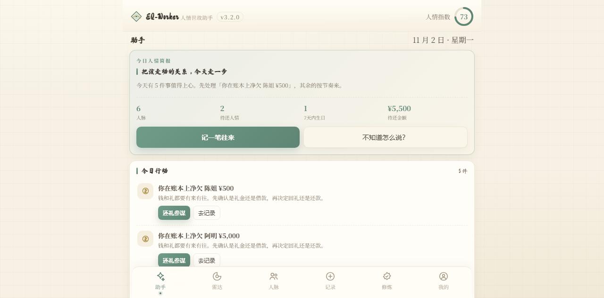
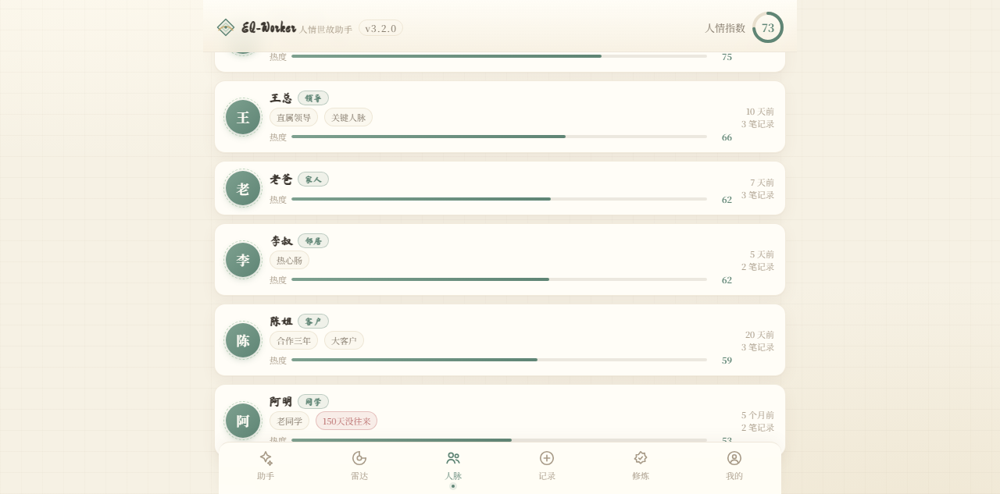
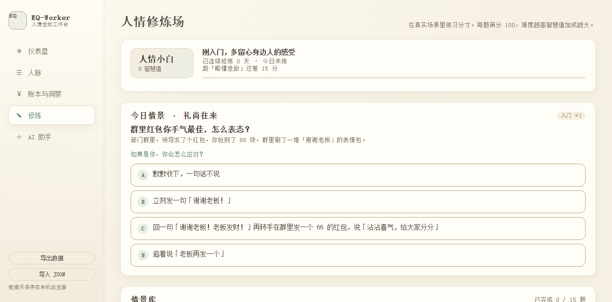
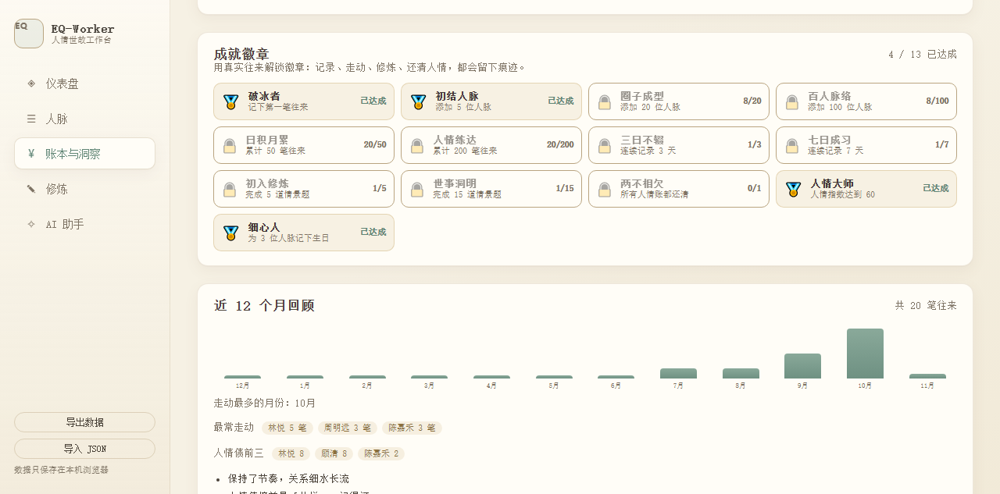

<div align="center">


# EQ-Worker

**Remember what you owe people. Never lose a relationship to a forgotten detail.**

Relationship ledger · Gift advisor · Script advisor · Health check · Practice & achievements

Local-first · No account · No server · Optional AI with your own key

<b>English</b> · <a href="README.zh.md">简体中文</a>

[](CHANGELOG.md)
[](LICENSE)
[](tests/)
[](#five-ways-to-use-it)

**Try it:** [X33834](https://x33834.github.io/EQ-Worker/) · [badhope](https://badhope.github.io/EQ-Worker/) · [Morningstar202604](https://morningstar202604.github.io/EQ-Worker/)
**Mirrors:** [GitCode](https://gitcode.com/badhope/EQ-Worker) · [Gitee](https://gitee.com/badhope/EQ-Worker) · [GitHub](https://github.com/badhope/EQ-Worker)

</div>

---

## What it solves

Nobody forgets that relationships matter. People forget the specifics.

| What you run into | What EQ-Worker gives you |
| --- | --- |
| Who helped you, whom you still owe a meal | A card per person: warmth, trust, social debt, last contact |
| How much to give at a wedding, baby shower, housewarming | Three tiers **with the arithmetic shown**, not a number pulled from thin air |
| Declining a loan, chasing a repayment, apologising — words that won't come out | 16 scenarios × 3 tones, copy and adjust |
| Not noticing a relationship fading | Health check ranks every relationship; it tells you which to fix first |
| No idea whether the year went well | 12-month review and 13 achievement badges |

> Not a fancier contacts app — the assistant that thinks about your obligations before you do.

---

## Screens

<table>
<tr>
<td width="50%"><br /><sub><b>Daily actions</b> — open it and you know what to do today</sub></td>
<td width="50%"><br /><sub><b>Ledger</b> — gifts given and received, net balance at a glance</sub></td>
</tr>
<tr>
<td><br /><sub><b>Gift advisor</b> — three tiers plus the reasoning</sub></td>
<td><br /><sub><b>Script advisor</b> — three tones, personalised, copyable</sub></td>
</tr>
<tr>
<td><br /><sub><b>One-tap settle</b> — partial settlement supported</sub></td>
<td><br /><sub><b>Health check</b> — fix the relationship that needs it most</sub></td>
</tr>
<tr>
<td><br /><sub><b>Practice arena</b> — rehearse real scenarios</sub></td>
<td><br /><sub><b>Achievements</b> — unlocked by real interactions</sub></td>
</tr>
</table>

---

## Five ways to use it

One engine, five entry points. The data format is shared, so you can move between them with import/export.

### 1 · Web (zero install)

Open `EQ-Worker.html` directly, or:

```bash
python3 -m http.server 8000   # then open http://localhost:8000
```

PWA-installable and works offline. The Android and Windows builds share this exact artifact.

### 2 · Windows desktop (installer)

Run `EQ-Worker-3.5.0-x64.exe`: Start-menu entry, desktop shortcut, uninstaller, selectable install directory.

### 3 · CLI (manage relationships in a terminal)

```bash
eqw overview                        # index, ledger, what to do today
eqw persons                         # contact list
eqw person "Wang"                   # one person, full picture
eqw gift "Chen" --occasion 婚礼      # gift advisor
eqw script refuse_loan --to "Zhang"  # how to decline a loan
eqw record --to "Wang" --type meal --title "dinner"
eqw export --format csv > ledger.csv
```

Every command supports `--json` for piping into scripts or `jq`.

### 4 · Local web console

```bash
node dist-server/server.mjs
# → http://127.0.0.1:4317/  — the access token is printed in the terminal
```

Five views: overview, contacts, ledger, health, advisors. **Loopback-only**, and every endpoint except the health probe requires a Bearer token.

### 5 · MCP (let AI read your relationship data)

Any MCP-capable client (Claude Desktop, Cursor, Cline) can call it:

```json
{
  "mcpServers": {
    "eq-worker": {
      "command": "node",
      "args": ["/path/to/dist-mcp/eq-worker-mcp.mjs"]
    }
  }
}
```

**15 tools** (overview, contacts, one person, ledger, health, gift, script, achievements, annual, search, reminders, practice + record, add-contact and add-reminder), **3 resources**, **2 prompts**.

Write tools declare `readOnlyHint: false` per the MCP spec, so the host asks the user before touching data.

---

## Why it's trustworthy

| Claim | How | How to check |
| --- | --- | --- |
| Data never leaves the device | No server, no account, no telemetry; AI is off by default and **makes zero requests** while off | A test asserts the request count is 0 while disabled |
| It won't silently destroy data | Unsafe migrations switch to write-protected; corrupt files are refused rather than overwritten; file storage writes atomically | `tests/cli.test.mjs` has a "corrupt file is preserved" case |
| The maths is right | The core engine is compared **function by function** against the legacy implementation: 6 fixtures × 16 functions | `packages/core/tests/engine.parity.test.ts` |
| It actually runs | Not just unit tests: CLI 16, server 17, MCP 18 — real processes, real sockets, real protocol | `node scripts/run-tests.mjs` |

**508 tests**: 190 Node tests + 318 Vitest tests across 30 files.

---

## Architecture

```
┌──────────────────────────────────────────────────────────┐
│  packages/core · pure logic, zero deps, browser + WeChat  │
│  engine · ledger · health · scripts · achievements        │
└──────────────────────────────────────────────────────────┘
        ▲            ▲            ▲            ▲
        │            │            │            │
 ┌──────┴───┐ ┌──────┴───┐ ┌──────┴───┐ ┌──────┴────┐
 │ legacy   │ │  Studio  │ │ Mini     │ │ apps/*    │
 │ single   │ │ Vite +TS │ │ Program  │ │ CLI·srv   │
 │ file PWA │ │          │ │          │ │ ·MCP      │
 └──────────┘ └──────────┘ └──────────┘ └───────────┘
      localStorage                    JSON file (atomic write)
```

**Layering rule**: `packages/core` must never import `node:fs` — it has to run in a browser and in a
WeChat Mini Program. Anything filesystem-bound lives in `packages/node`. The boundary is enforced by
the build: `vite build` fails outright if `node:fs` leaks in.

---

## Quick start

```bash
pnpm install
pnpm run verify    # version check → 7 builds → lint → 190 tests → typecheck → 318 tests → both bundles
```

Build one target at a time:

```bash
node build.js                     # legacy web app (synced to android / desktop)
node scripts/build-cli.mjs         # CLI    → dist-cli/eqw.mjs
node scripts/build-server.mjs      # server → dist-server/
node scripts/build-mcp.mjs         # MCP    → dist-mcp/
cd desktop && npx electron-builder --win nsis   # installer
```

---

## Docs

| | |
| --- | --- |
| [ARCHITECTURE.md](ARCHITECTURE.md) | Layers, boundaries, trade-offs |
| [docs/AUDIT.md](docs/AUDIT.md) | Feature reality-check report |
| [docs/adr/](docs/adr/) | Five architecture decision records |
| [CHANGELOG.md](CHANGELOG.md) | Version history with verification evidence |
| [CONTRIBUTING.md](CONTRIBUTING.md) | Development conventions |
| [SECURITY.md](SECURITY.md) | Reporting and security boundaries |
| [ROADMAP.md](ROADMAP.md) | Plans and definition of done |

---

## License

[CC BY-NC 4.0](LICENSE) — free for personal use and learning; commercial use requires permission.

<div align="center">

**人情不是算计，是把别人放在心上。**
*Relationships aren't transactions. They're people you keep in mind.*

</div>
