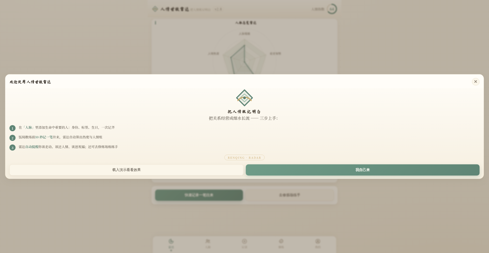
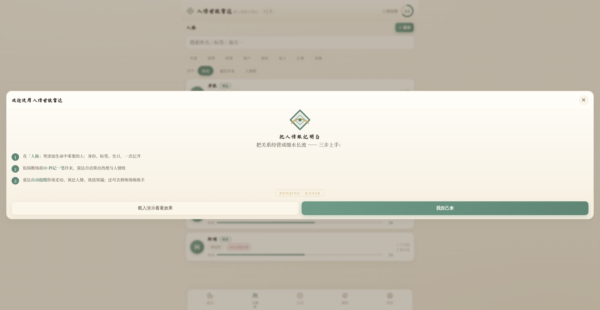
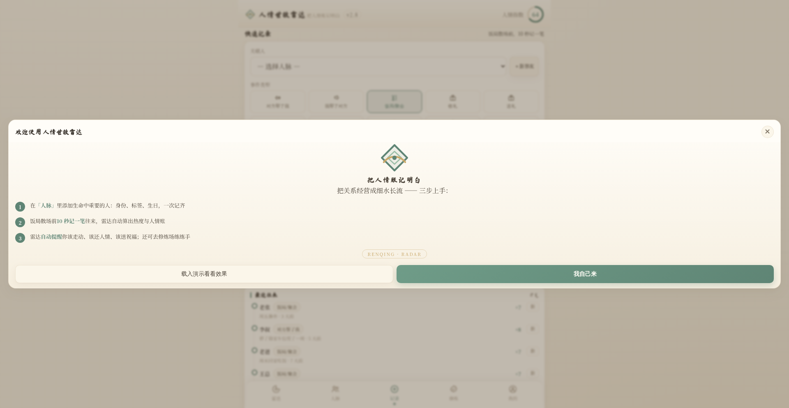
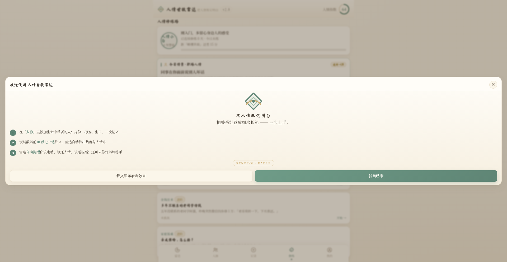
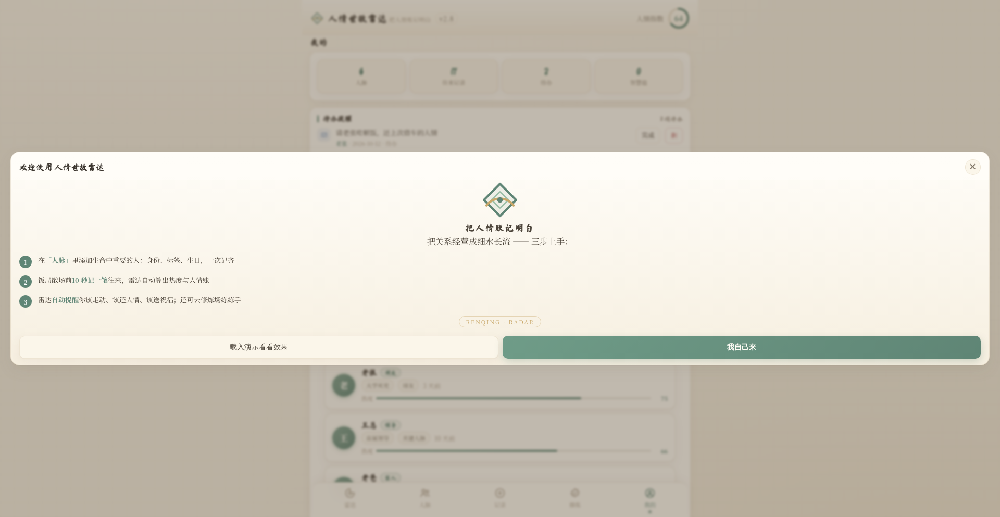
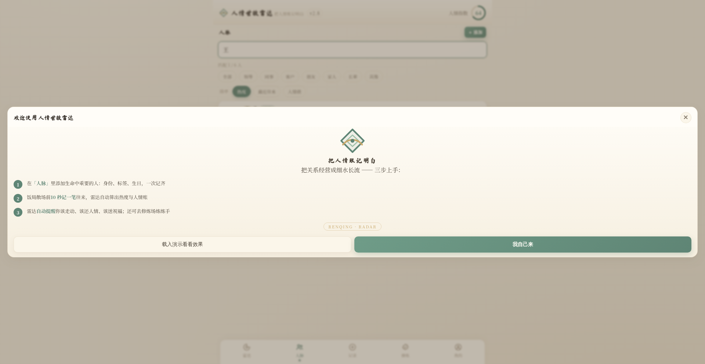
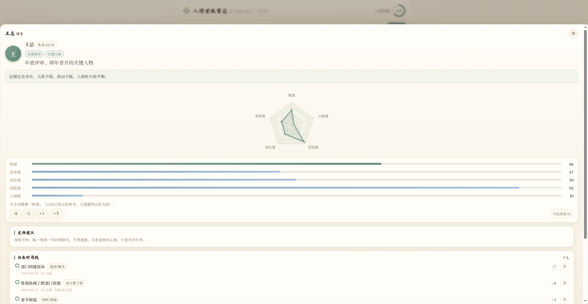

<div align="center">

# RENQING · RADAR

**人情世故雷达 — Keep your favors clear, keep your relationships flowing.**

Relationship management · Favor ledger · Social practice — lightweight, **local-first**, private-by-design.

<a href="README.zh.md"><b>简体中文</b></a> · <a href="README.md">English</a>

[](https://github.com/Morningstar202604/chushi-radar)
[](https://github.com/Morningstar202604/chushi-radar/releases)
[](LICENSE)
[](https://github.com/Morningstar202604/chushi-radar/stargazers)

**Mirror repos:** [GitHub @badhope](https://github.com/badhope/chushi-radar) · [GitHub @x33834](https://github.com/x33834/chushi-radar) · [GitHub @Morningstar202604](https://github.com/Morningstar202604/chushi-radar) · [GitCode](https://gitcode.com/badhope/chushi-radar) · [Gitee](https://gitee.com/badhope/chushi-radar)

</div>

---

## ✨ Try Online

| Channel | Link |
|---|---|
| **Web (GitHub Pages, auto-deploy)** | <https://morningstar202604.github.io/chushi-radar/> |
| **Mirror (GitHub @x33834)** | <https://x33834.github.io/chushi-radar/> |
| **Mirror (GitHub @badhope)** | <https://badhope.github.io/chushi-radar/> |
| **Official Brand Site** | <https://morningstar202604.github.io/chushi-radar/%E5%AE%98%E7%BD%91/%E4%BA%BA%E6%83%85%E4%B8%96%E6%95%85%E9%9B%B7%E8%BE%BE%E5%AE%98%E7%BD%91.html> |

> **No internet at all?** Just download `人情世故雷达.html`, open it in any browser — fully offline-capable, identical functionality.

---

## 📸 Screenshots

| Radar Overview | People Management | Quick Record |
| --- | --- | --- |
|  |  |  |

| Practice Arena | My Data Center | Search Highlight |
| --- | --- | --- |
|  |  |  |


*Five-axis radar + warmth metrics + interaction timeline + relationship insight*

---

## 🎯 What Is This

**RENQING · RADAR (人情世故雷达)** is a **relationship-keeping tool**, not a personality quiz.

> *Renqing* (人情) = the unspoken currency of favors, debts, and care that oils human relationships.

The legacy "Chushi Radar" was an 81-question social-intelligence test. Since v2, it has been rebuilt as a **keep-and-grow** workflow:

1. **Spend 10 seconds** after a dinner recording one interaction
2. The **radar does the rest** — auto-drawing profiles, computing warmth scores, and nudging you whom to visit, which favor to return, and whose birthday to celebrate

### Who is it for

- People who attend dinners, weddings, and gatherings and want to manage the "favor bank"
- Anyone tired of forgetting birthdays, missing festival greetings, or owing invisible debts
- Learners of Chinese social scenarios — 15 built-in practice cases with difficulty tiers

---

## 🔁 Core Loop (5 Closed Modules)

```
Record interactions → Auto profile → Smart reminders → Scenario training → Annual report
```

| Module | What it does |
| --- | --- |
| **Radar Overview** | 5-dimension profile (network scale / warmth / frequency / credit / wisdom) + composite index + smart reminders (festivals, favors owed, long-no-contact, birthdays, todos — color-coded by urgency) |
| **People Management** | One radar card per person; warmth = event weighting + 90-day half-life decay, manually adjustable; search / role filter / 3 sort modes |
| **Quick Record** | 10 interaction types auto-weighted (dinner, help, gifts, loans, heart-to-heart…); undo supported |
| **Practice Arena** | 15 Chinese social scenarios (wedding gifts, toasting, borrowing money, saving face…), difficulty tiers, raises wisdom & level |
| **My Data** | Monthly insights, 6-month trend, annual report, todo management, backup & migration (clipboard / file / CSV) |

---

## 📱 Two Platforms, One Data Format

| Platform | Description |
| --- | --- |
| **Web (PWA)** | Single self-contained HTML (~1.1 MB, zero build), works offline, installable to home screen; built-in open-source ECharts visualization |
| **WeChat Mini Program** | Full mini-program project (`chushi-radar/人情世故雷达-小程序/`), hand-drawn radar on Canvas with zero dependencies; web↔mini data is fully interoperable (SCHEMA_VERSION) |

### Mini Program Highlights

- **Custom UI components** — unified modal/toast with smooth entrance/exit animations (replaces all native wx modals)
- **Search highlighting** — real-time yellow highlight on matching characters across name/identity/tags
- **Press feedback** — all interactive cards have scale-press animations
- **Urgency pulse** — overdue reminders pulse with red glow
- **Lunar calendar built in** — supports Chinese festival detection (1900–2100)

---

## 🔐 Data & Privacy

- **Zero server** — all data stays on your device (browser localStorage / mini-program local cache)
- **No analytics, no ads, no sign-up** — you are not the product
- **Seamless migration** — export → copy clipboard → paste-import on new device; web↔mini formats are interoperable
- Built-in Chinese lunar calendar for festival reminders (1900–2100)

---

## 🆕 What's New in v2.8.1

- **Unified UI components** — custom modal/toast system with smooth animations across all 7 mini-program pages
- **Search highlight** — find anyone instantly with yellow character-level highlighting + match count
- **Relationship network graph** — Canvas ring layout showing all connections (web)
- **Annual report PNG export** — html2canvas-powered one-tap image sharing (web)
- **Performance** — computePerson global cache + event-versioned invalidation
- **PWA support** — Service Worker Cache First strategy for fully offline web
- **Build system** — zero-dep ESM build script (`build.js`)
- **Unit tests** — 10 passing tests via `node --test`

---

## 🛠 Tech Stack

| Layer | Choice |
| --- | --- |
| Language | Vanilla JavaScript (zero framework) |
| Chart | ECharts 5 (inlined) / Canvas 2D (mini program) |
| Storage | localStorage / wx.storage (local-only) |
| PWA | Service Worker + Cache First |
| Build | `build.js` — ESM, zero dependencies |
| Test | `node --test` built-in runner |

---

## 📦 Quick Start

- **Web**: open `人情世故雷达.html` directly in Chrome, Safari, or WeChat browser
- **Mini Program**: import `chushi-radar/人情世故雷达-小程序/` into WeChat DevTools

---

## 📄 License

Creative Commons Attribution-NonCommercial 4.0 International (CC BY-NC 4.0), see [`LICENSE`](LICENSE).

---

<div align="center">

⭐ **Star this repo** if it helps · 🍴 **Fork** to build your own · 🐛 **Issues** are welcome

</div>
