<div align="center">

# EQ-Worker

**Remember what you owe people. Never lose a relationship to a forgotten detail.**

Daily actions · Relationship ledger · Gift advisor · Script advisor · Health check

Local-first · No account · Optional AI you bring yourself

<a href="README.md"><b>English</b></a> · <a href="README.zh.md">简体中文</a>

[](https://gitcode.com/badhope/EQ-Worker)
[](LICENSE)
[](https://github.com/badhope/EQ-Worker/actions)
[](#which-client-should-i-use)

**Try it:** [X33834](https://x33834.github.io/EQ-Worker/) · [badhope](https://badhope.github.io/EQ-Worker/) · [Morningstar202604](https://morningstar202604.github.io/EQ-Worker/)

**Mirrors:** [GitCode](https://gitcode.com/badhope/EQ-Worker) · [Gitee](https://gitee.com/badhope/EQ-Worker) · [GitHub](https://github.com/badhope/EQ-Worker)

</div>

---

## The problem

Nobody forgets that relationships matter. People forget the specifics:

- Who helped you last month, and what you still owe them
- How much to give at a wedding, a baby shower, a housewarming, a hospital visit
- How to decline a loan request, chase a repayment, or apologise — without the words coming out wrong

EQ-Worker is a workbench for those specifics. Open it and it tells you what to do today. Then it
gives you the ledger, a gift range with the reasoning shown, and scripts you can copy and adjust.

It is not a fancier contacts app. It is the assistant that thinks about your obligations before you do.

---

## What it does

### Today's actions

One ranked list combining upcoming dates, pending reminders, outstanding debts, relationships that
have gone quiet, and thank-yous you owe. Every item carries two buttons that do the next thing —
open the gift advisor, generate a script, or record the interaction in ten seconds.

### Relationship ledger

Record gifts given and received, loans, and repayments. See your net position per person and across
everyone.

- **One-tap settlement** turns a net balance into an actual record: repayment, return gift, or
  incoming repayment. Partial settlement is supported.
- **Ledger insights**: given this month, received this month, average gift, most-invested occasion.
- **Amounts never affect relationship scores.** Money lives in the ledger; heat, trust, and
  obligation are separate, so the two cannot contaminate each other.

### Gift advisor

Given relationship, occasion, tier, and city, it returns three amounts — modest, appropriate, and
generous — and explains each one: the base reference, what they gave you before (a return gift
should not be less), an upward adjustment when you owe them, and their stated preferences.

> Gift amounts vary enormously by region and local custom. The advisor is a reference, not a rule.

### Script advisor

16 everyday situations, three tones each (steady, close, brief), with the person's name filled in.
Some scripts also reference your recent history with that person. Copy, adjust, send.

### Relationship health

A composite score from relationship indicators, ledger reciprocity, and recent friction, with a
ranked list so you fix the most neglected relationship first.

### Everything else

Contact profiles, quick record with undo, search and filters, scenario practice, monthly insights,
annual report, relationship network, achievements, and offline PWA support.

---

## Screenshots

| Today's actions | Relationship ledger |
| --- | --- |
|  | 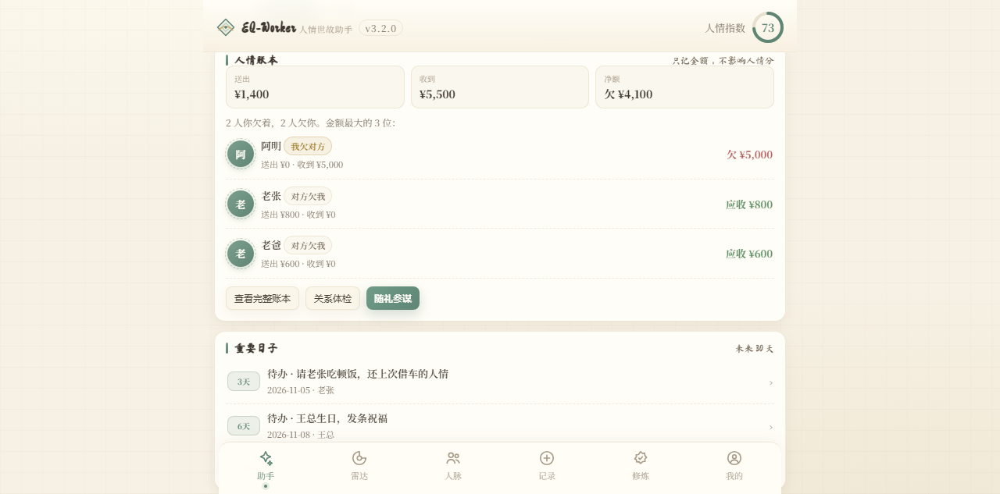 |

| Gift advisor | Script advisor |
| --- | --- |
| 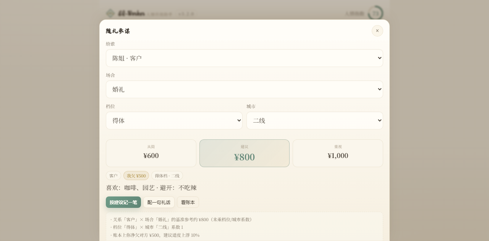 | 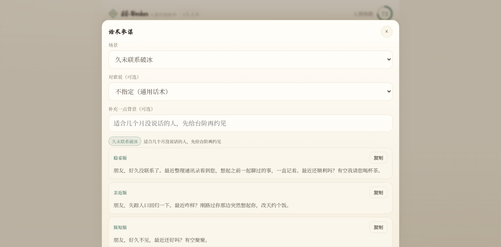 |

| Quick record | Mobile |
| --- | --- |
| 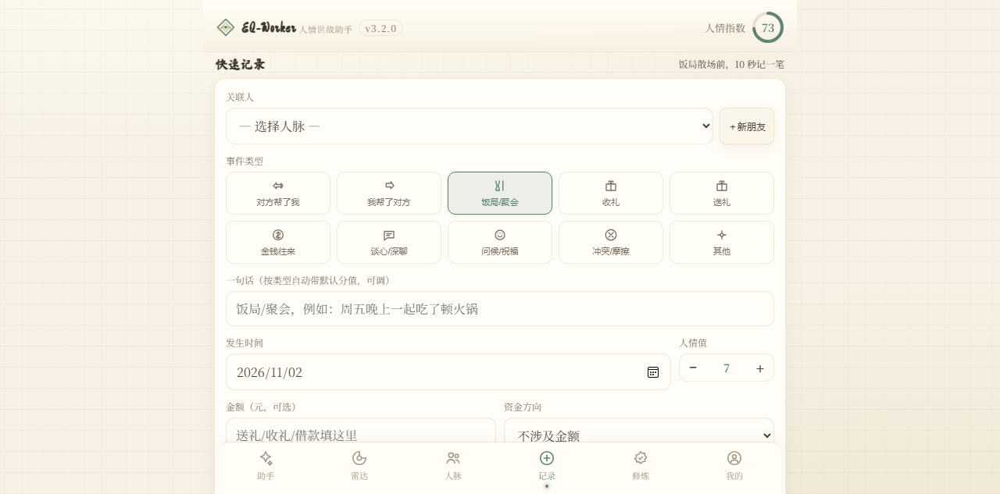 | 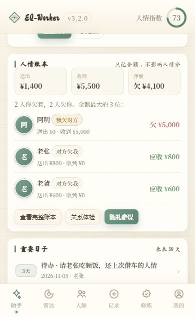 |

| Ledger insights | One-tap settlement |
| --- | --- |
| 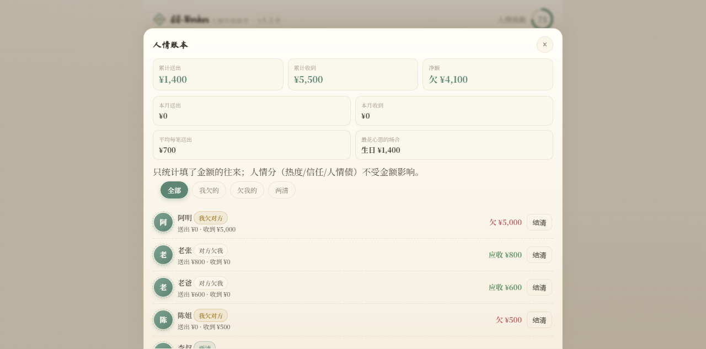 |  |

| Settlement history | Relationship health |
| --- | --- |
| 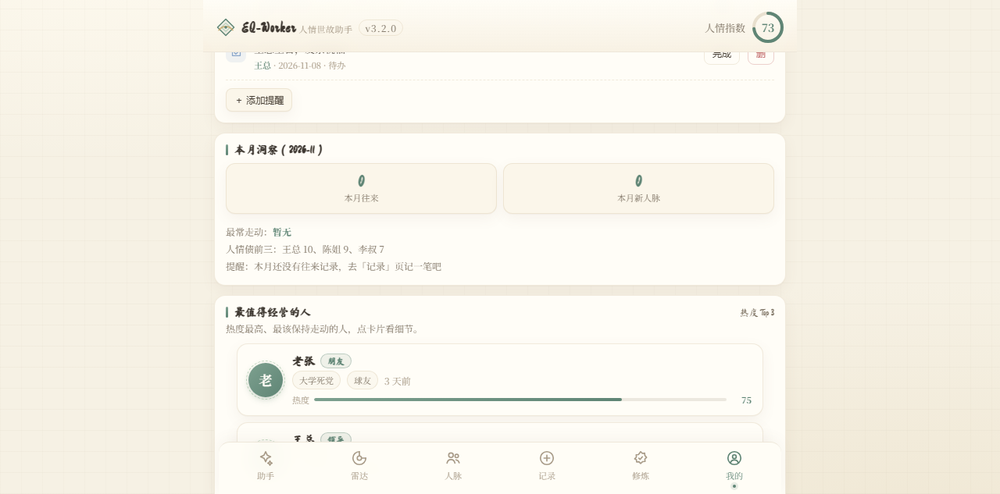 | 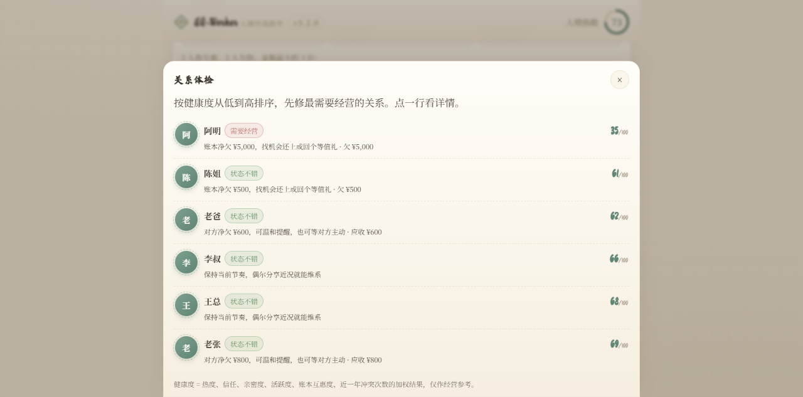 |

| Studio workbench | Studio AI (off by default) |
| --- | --- |
| 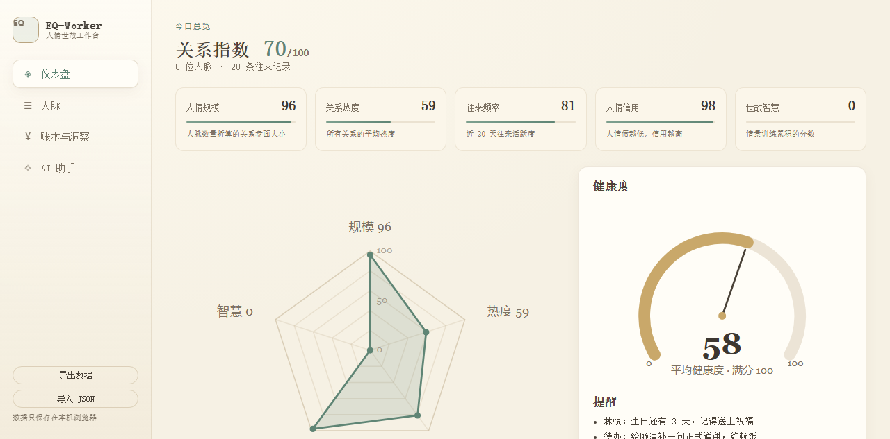 | 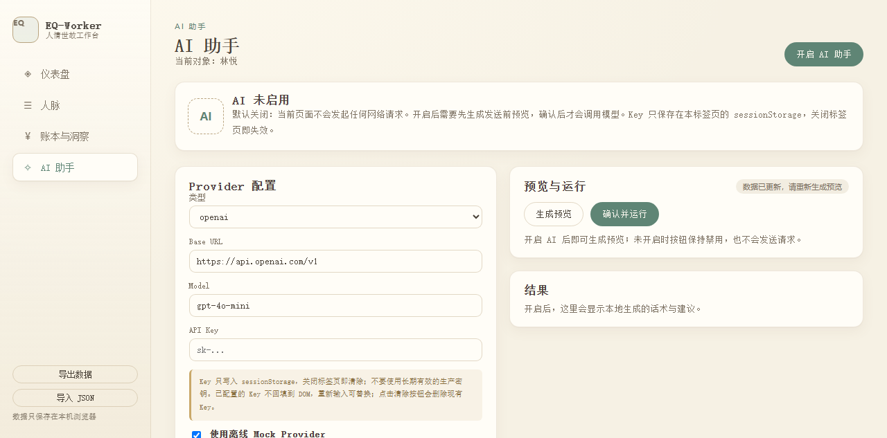 |

| Practice arena | Answer feedback |
| --- | --- |
|  | 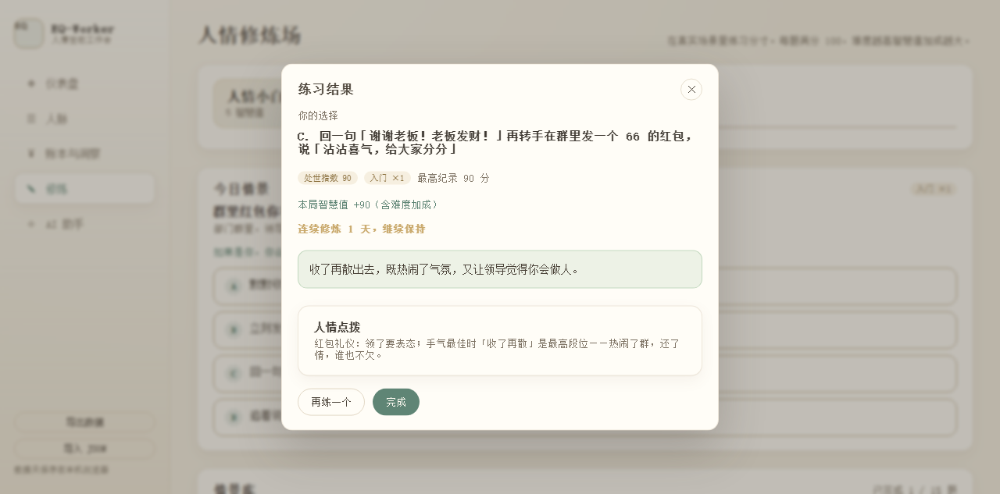 |

| Achievement badges | Twelve-month review |
| --- | --- |
|  | 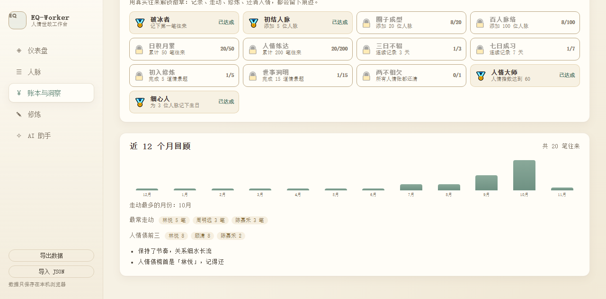 |

---

## Which client should I use?

| Client | State | What you get |
| --- | --- | --- |
| **Web (PWA)** | Complete | Every feature, installable, works offline |
| **Android** | Complete | Native WebView shell around the web client; ~1.4 MB APK |
| **Windows desktop** | Complete | Electron shell, portable zip, no installer |
| **Studio** | Separate build | A denser workbench: overview, contacts, ledger and insights, practice, optional AI |
| **WeChat Mini Program** | Lightweight | Radar, contacts, record, practice, profile, plus gift and script advisors |

The web, Android, and desktop clients share **one** build artifact, so a fix lands everywhere at
once. Studio is built separately and is not included in the release packages. The Mini Program is a
deliberately smaller companion.

### Feature coverage

| Capability | Web / Android / Desktop | Studio | Mini Program |
| --- | --- | --- | --- |
| Daily actions and reminders | Yes | Yes (overview) | Yes |
| Ledger and settlement | Yes | Yes | Yes |
| Gift advisor | Yes | Yes | Yes |
| Script advisor | Yes | Yes (inside AI view) | Yes |
| Relationship health | Yes | Yes (ledger page) | Yes |
| Practice arena | Yes | Yes | Yes |
| Achievement badges | Yes | Yes | Yes |
| Annual review | Yes | Yes (12-month review) | Yes |
| Optional AI | No (rules only) | Yes, off by default | No |

Achievement rules, practice scoring, and annual statistics all live in `packages/core`, so the three
clients share one implementation instead of each carrying its own copy.

---

## Quick start

### Web

Open `EQ-Worker.html` directly, or serve the directory:

```bash
python3 -m http.server 8000
# open http://localhost:8000/
```

For PWA offline support, serve over HTTP(S) and keep `index.html`, `EQ-Worker.html`,
`sw-register.js`, and `sw.js` together. Service workers require a secure context.

### Build from source

```bash
pnpm install
pnpm run dev:studio     # Studio dev server
pnpm run build:studio   # build Studio to dist-studio/
pnpm run test           # legacy node:test + Vitest
pnpm run verify         # full gate: version, builds, tests, typecheck, dist
```

`pnpm run verify` is the definition of green. It checks version consistency, rebuilds every
artifact, runs both test suites, type-checks, and builds both Vite targets.

### Android and Windows

See [`docs/双端构建与发布.md`](docs/双端构建与发布.md) (Chinese) and
[`docs/RELEASE.md`](docs/RELEASE.md) (release checklist, signing, artifact verification).

### WeChat Mini Program

Import `EQ-Worker-小程序/` into WeChat DevTools.

---

## Architecture

Four layers, one source of truth for the rules:

```
shells     android/  desktop/            (embed the legacy build)
UIs        _app_dev.js  apps/studio  EQ-Worker-小程序/
packages   packages/ai  packages/viz
core       packages/core                  (pure domain, no DOM)
```

`packages/core` holds the ledger math, health scoring, sanitization, and advice rules as pure
functions. Every client consumes it, which is why the numbers agree across clients. Charts in
`packages/viz` are deterministic SVG strings with no runtime dependencies, so the single-file build
does not carry a charting library. AI in `packages/ai` is off by default and speaks to providers
through a minimal fetch interface rather than an SDK.

Full reasoning, including the trade-offs we accepted: [`ARCHITECTURE.md`](ARCHITECTURE.md) and
[`docs/adr/`](docs/adr/).

---

## Data and privacy

- **Local by default.** Records live in `localStorage`, WebView storage, or `wx.storage`. No account,
  no server, no analytics.
- **Exports are sanitized.** A JSON backup contains your relationship data and deliberately excludes
  AI provider configuration and keys.
- **AI is opt-in and previewed.** Disabled by default with zero network requests. When you enable it,
  you see the exact text that will be sent and must confirm before anything leaves the device.
  Changing the person, context, provider, or model invalidates that approval.
- **Fail closed on storage trouble.** If a migration would lose data, the app refuses to write and
  tells you, rather than overwriting. If a save fails, it says so instead of pretending success.

Read [`docs/ai-privacy.md`](docs/ai-privacy.md) for the precise boundary, including what we cannot
guarantee.

---

## Project management

| Document | Purpose |
| --- | --- |
| [ROADMAP.md](ROADMAP.md) | What shipped, what's next, and what "done" means |
| [CHANGELOG.md](CHANGELOG.md) | Version history with verification evidence |
| [CONTRIBUTING.md](CONTRIBUTING.md) | Setup, conventions, testing expectations |
| [ARCHITECTURE.md](ARCHITECTURE.md) | Layers, boundaries, and why |
| [docs/adr/](docs/adr/) | Decisions that are expensive to reverse |
| [docs/RELEASE.md](docs/RELEASE.md) | Release checklist, signing, artifact parity |
| [SECURITY.md](SECURITY.md) | Reporting, scope, AI red lines |
| [SUPPORT.md](SUPPORT.md) | Where to ask what |
| [CODE_OF_CONDUCT.md](CODE_OF_CONDUCT.md) | Community standards |

Version numbers are single-sourced from `package.json`; `scripts/sync-version.mjs` derives and
verifies every other location, and `pnpm run verify` fails on drift.

---

## Tech stack

| Layer | Choice |
| --- | --- |
| Language | TypeScript (packages, Studio) and JavaScript (legacy single-file client) |
| Charts | Canvas 2D (Mini Program) · ECharts 5 (legacy) · deterministic SVG (packages/viz) |
| Storage | `localStorage` · `wx.storage` · in-memory fallback |
| Build | `build.js` (legacy) · Vite (Studio, web) |
| Tests | `node:test` (legacy + cross-end parity) · Vitest |
| Native shells | Android WebView + WebViewAssetLoader · Electron 44 |

---

## Version 3.2.0

- TypeScript core extracted to `packages/core`, parity-tested against the legacy engine
- New `packages/viz` (SVG charts), `packages/ai` (opt-in), and `apps/studio`
- Mini Program now consumes the core bundle; the duplicated engine is gone
- Dual build chain with a single `verify` gate
- Storage hardening: write protection, verified backups, in-memory fallback, save rollback
- Version single-sourced and enforced

Earlier releases: [CHANGELOG.md](CHANGELOG.md).

---

## License

Creative Commons Attribution-NonCommercial 4.0 International (CC BY-NC 4.0). See [LICENSE](LICENSE).

<div align="center">

**Etiquette is not calculation. It is keeping people in mind.**

</div>
