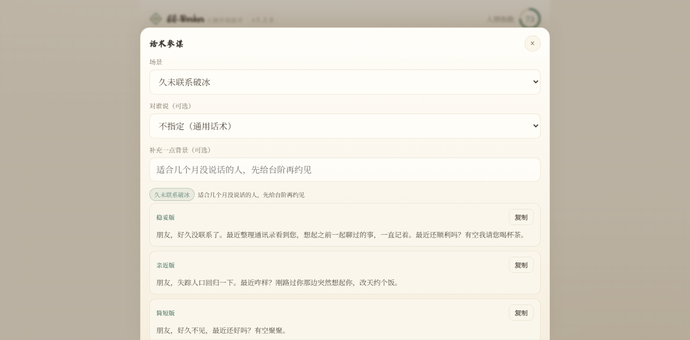
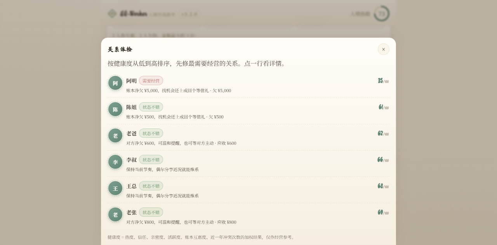

<div align="center">


# EQ-Worker

**记住你欠谁的人情。**

<a href="README.md">English</a> · <b>简体中文</b>

[](CHANGELOG.md)
[](tests/)
[](LICENSE)

[**在线打开 →**](https://x33834.github.io/EQ-Worker/) · [Windows](https://github.com/badhope/EQ-Worker/releases) · [安卓](https://github.com/badhope/EQ-Worker/releases)

</div>

---

## 它做什么

| | |
| --- | --- |
| **随礼参谋** | 关系 × 场合 × 档位 × 城市，给出三档金额并写明每一档怎么算出来的 |
| **红白事分轨** | 帛金走单数档、喜事走吉数档；红白事不可对冲 |
| **送礼避雷** | 钟/伞/梨/鞋/白菊/刀具等忌讳，按场合适配（探病、寿宴另有一套） |
| **人情账本** | 送礼、收礼、借款分账；谁欠谁、欠多少，一眼看清 |
| **话术参谋** | 20 个真实场景 × 3 种语气，拒绝借钱、催还、吊唁、敬酒都能直接用 |
| **关系体检** | 找出最该经营的那一段，告诉你下一步做什么 |

---

## 界面

<table>
<tr>
<td width="50%"><br /><sub><b>随礼参谋</b> — 三档金额 + 算式 + 礼俗提醒</sub></td>
<td width="50%"><br /><sub><b>人情账本</b> — 收送分账，净额一眼可见</sub></td>
</tr>
<tr>
<td><br /><sub><b>话术参谋</b> — 20 场景 × 3 语气，可直接复制</sub></td>
<td><br /><sub><b>关系体检</b> — 按健康度排序，先修最该修的</sub></td>
</tr>
</table>

---

## AI 与联网的真实边界

这一节写清楚能力到什么程度，避免误会。

| 能力 | 状态 |
|---|---|
| AI 生成话术 / 随礼说明 / 复盘 | ✅ 有，4 条流水线，默认关闭、用户自备 Key |
| AI 调用本地函数查数据 | ✅ 8 个只读工具（找人 / 算随礼 / 查账本 / 查礼俗 / 生成话术 / 今日行动 / 健康排行） |
| 联网搜索 | ⚠️ **可选，默认关闭**。支持「模型自带联网」与「独立搜索接口」两种后端，需自行填 Key |
| 联网搜索的免费方案 | ❌ 内置的免费额度**没有**。搜索接口按次计费，或自建 SearXNG |
| 本地礼俗知识库 | ✅ 内置「全国通行」包，可导入地区包与本地行情覆盖 |
| 向量检索 / RAG | ❌ 没有 |

关键约束：

- **默认零网络请求**。有测试断言：把「默认关闭」改掉，测试立刻变红。
- 未开启联网时，界面**不渲染** Key 与地址输入框。
- 开启后明确提示「查询会离开本机」，且查询不携带姓名、备注、金额。
- AI 工具调用**全部只读**，姓名默认脱敏为「这位朋友」。

---

## SDK

想把随礼计算、礼俗规则、话术生成嵌进别的项目：

```bash
node scripts/build-sdk.mjs
# → dist-sdk/eq-worker-sdk.mjs  (ESM，零依赖，89 项导出)
```

```js
import { createEmptyState, giftAdvice } from './eq-worker-sdk.mjs';
const advice = giftAdvice(state, 'p1', '白事');   // ¥501 / ¥701 / ¥1001，全单数
```

详见 [docs/SDK.md](docs/SDK.md)。

---

## 安装

```bash
git clone https://gitee.com/badhope/EQ-Worker.git
cd EQ-Worker && pnpm install && pnpm run verify
```

| 平台 | 方式 |
| --- | --- |
| 网页 | 直接打开 `EQ-Worker.html`，或访问 [在线版](https://x33834.github.io/EQ-Worker/) |
| Windows | [Releases](https://github.com/badhope/EQ-Worker/releases) 下载 `EQ-Worker-3.6.0-x64.exe` |
| 安卓 | [Releases](https://github.com/badhope/EQ-Worker/releases) 下载 APK |
| 微信小程序 | 开发者工具导入 `EQ-Worker-小程序/` |
| CLI / MCP | `node dist-cli/eqw.mjs` · `node dist-mcp/eq-worker-mcp.mjs` |

---

## 文档

[ARCHITECTURE.md](ARCHITECTURE.md) · [CHANGELOG.md](CHANGELOG.md) · [CONTRIBUTING.md](CONTRIBUTING.md) · [SECURITY.md](SECURITY.md)

<div align="center">

**人情不是算计，是把别人放在心上。**

</div>
