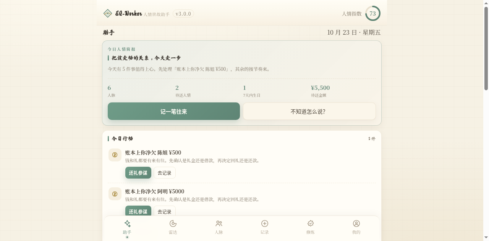
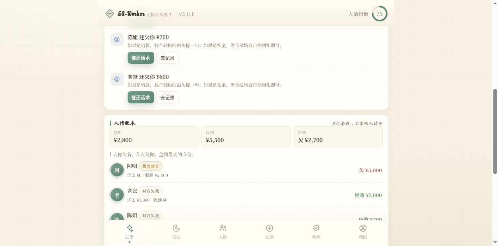
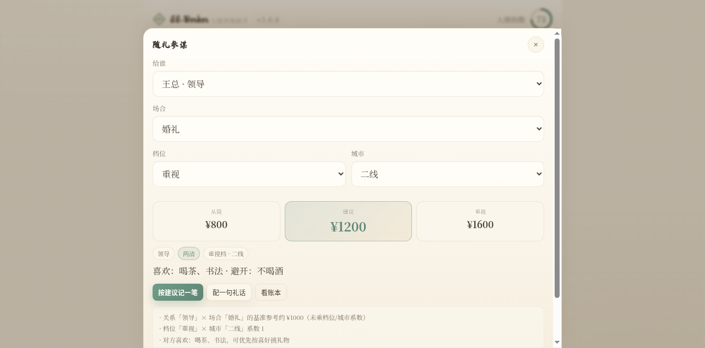
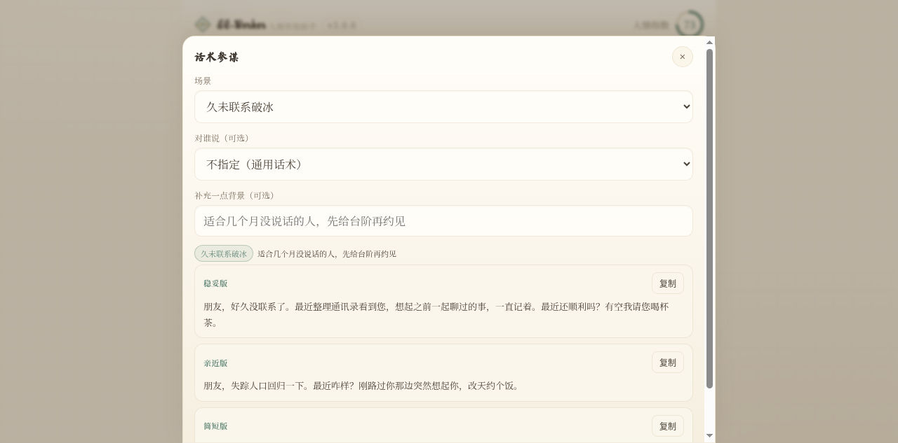
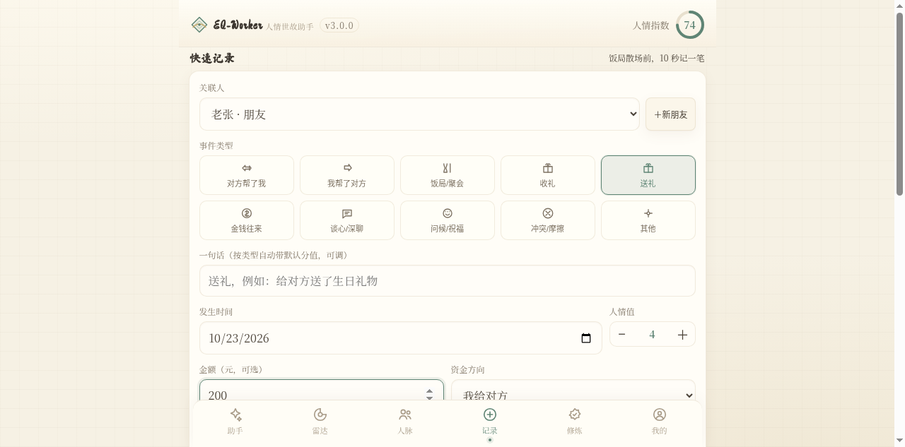
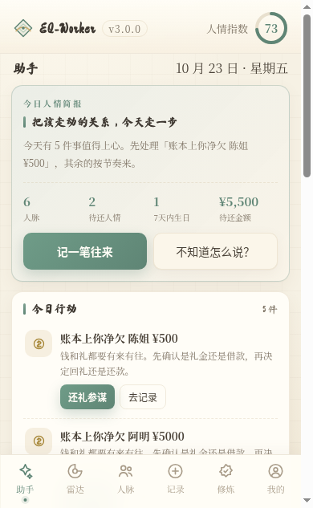
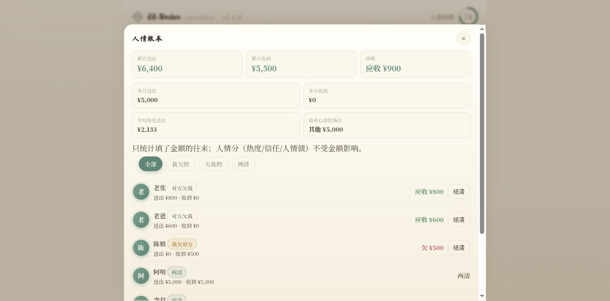
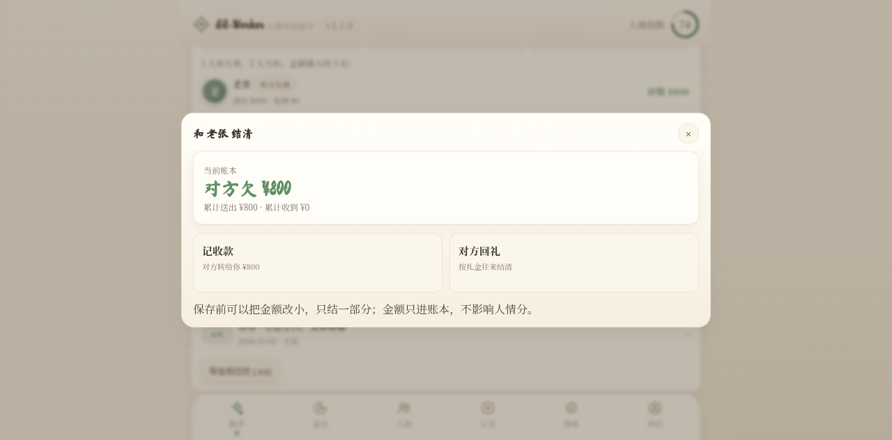
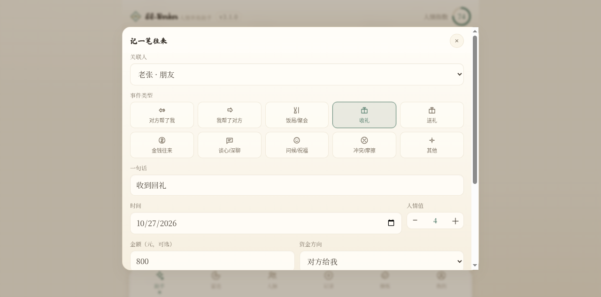
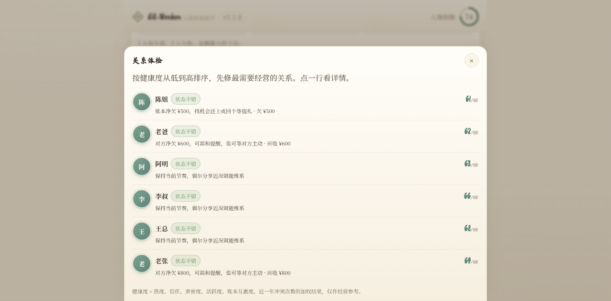

<div align="center">

# EQ-Worker

**人情世故助手 — 把人情顾好，不用靠记性。**

今日行动 · 人情账本 · 随礼参谋 · 话术参谋 · 关系体检

本地优先 · 零服务器 · 无广告 · 无埋点

<a href="README.zh.md"><b>简体中文</b></a> · <a href="README.md">English</a>

[](https://gitcode.com/badhope/EQ-Worker)
[](LICENSE)

**在线体验：** [X33834](https://x33834.github.io/EQ-Worker/) · [badhope](https://badhope.github.io/EQ-Worker/) · [Morningstar202604](https://morningstar202604.github.io/EQ-Worker/)

**仓库：** [GitCode](https://gitcode.com/badhope/EQ-Worker) · [Gitee](https://gitee.com/badhope/EQ-Worker) · [GitHub @badhope](https://github.com/badhope/EQ-Worker) · [GitHub @X33834](https://github.com/X33834/EQ-Worker) · [GitHub @Morningstar202604](https://github.com/Morningstar202604/EQ-Worker)

</div>

---

## 这是什么

大多数人不是不会处关系，而是**记不住、算不清、开不了口**：

- 谁帮过你、你欠谁一顿饭，散场就忘；
- 婚礼、满月、乔迁、探病，到底随多少才不失礼；
- 想拒绝借钱、想催还、想道歉，话到嘴边又咽回去。

EQ-Worker 把这些事收进一个**本地优先的人情工作台**：每天打开先告诉你「今天该做什么」，再给你账本、礼金区间和能直接复制的话术。

> 它不是一个更复杂的通讯录，而是一个**替你把人情想到前面**的助手。

---

## 核心功能

### 1. 今日行动（助手首页）

把生日、纪念日、待办、断联、欠人情、账本净额、该道谢、关键关系维护合成一份按紧急度排序的清单。

每条行动都带两个按钮，例如：

- 「还礼参谋」→ 直接给出礼金区间；
- 「破冰话术」→ 给出三种语气的现成说法；
- 「记一笔」→ 10 秒把这次走动记进账本。

### 2. 人情账本

- 送礼 / 收礼 / 借款 / 还款分别记「金额 + 方向 + 场合」；
- 单人净额：**我欠对方** / **对方欠我** / **两清**；
- 总账：累计送出、累计收到、净额、待还人数、待收人数；
- **一键结清**：把净额直接变成「还款 / 回礼 / 收款 / 对方回礼」记录，支持只结一部分；
- **账本洞察**：本月送出/收到、平均每笔、最花心思的场合；
- 支持筛选、CSV 导出；
- **金额只进账本，不影响热度/信任/人情债等人情分**，两套账互不污染。

### 3. 随礼参谋

按「关系 × 场合 × 档位 × 城市」给出 **从简 / 建议 / 重视** 三档金额，并说明依据：

- 关系与场合的基准参考；
- 对方过去在同类场合给过你多少（还礼不低于此数）；
- 账本净欠时适度上浮；
- 对方的喜好与忌讳（礼物选择提示）。

> 礼金受地区、亲疏、当地风俗影响很大，建议只是参谋，最终以你的真实关系和当地习惯为准。

### 4. 话术参谋

内置 16 个高频场景：破冰、道谢、道歉、请托、婉拒、拒绝借钱、催还、随礼、敬酒、探病、婉拒饭局、节日祝福、约饭、事后跟进、生日、纪念日。

每个场景给出 **稳妥版 / 亲近版 / 简短版**，并自动带入对方称呼、身份、最近一次往来，支持一键复制。

### 5. 关系体检

把热度、信任、亲密度、活跃度、账本互惠度、近一年冲突次数合成 0–100 的健康度，并给出可执行建议。支持**全局体检列表**，按健康度从低到高排序，先修最需要经营的关系。

### 6. 重要日子与日历

生日、纪念日按年循环，待办按单次事件，一键导出 `.ics` 到系统日历。

### 7. 原有能力保留

- 人脉画像：热度 / 亲密度 / 信任度 / 活跃度 / 人情债；
- 快速记录与撤销、搜索高亮、身份筛选、三种排序；
- 15 个中国式社交情景修炼与段位；
- 月度洞察、年度报告、关系网络图；
- 成就徽章、PWA 离线、备份/剪贴板/CSV 迁移。

---

## 截图

| 助手首页 | 人情账本 |
| --- | --- |
|  |  |

| 随礼参谋 | 话术参谋 |
| --- | --- |
|  |  |

| 快速记录 | 移动端 |
| --- | --- |
|  |  |

| 账本洞察 | 一键结清 |
| --- | --- |
|  |  |

| 结清记录 | 关系体检 |
| --- | --- |
|  |  |

---

## 四端说明

| 端 | 状态 | 说明 |
| --- | --- | --- |
| **网页版（PWA）** | 完整功能 | 单文件自包含 HTML，离线可用，可添加到主屏幕 |
| **安卓 App** | 完整功能 | 原生 WebView 壳，内嵌同一份 `index.html` |
| **Windows 桌面版** | 完整功能 | Electron 免安装包，解压即用 |
| **微信小程序** | 轻量版 | 保留雷达、人脉、记录、修炼、我的；数据与 Web v4 结构兼容，但不含新版助手/参谋 UI |

> 网页、安卓、桌面三端共用同一份构建产物与同一套数据；小程序作为轻量随身端保留。

---

## 数据与隐私

- **零服务器**：所有数据只存本机（localStorage / wx.storage）；
- **无注册、无广告、无埋点**；
- 备份格式为普通 JSON，网页 ↔ 小程序可互相导入；
- 旧版 `rqsg_radar_v2` 数据会自动迁移到 `eqworker_db_v1`，不丢历史记录。

---

## 快速开始

### 网页

直接打开 `EQ-Worker.html`，或启动本地静态服务：

```bash
python3 -m http.server 8000
# 打开 http://localhost:8000/
```

### 构建与测试

```bash
npm run build   # _app_dev.js + index.template.html → index.html / EQ-Worker.html，并同步安卓与桌面产物
npm test        # 54 个单元测试
npm run verify  # 构建 + 全部测试
```

### 安卓 / Windows

见 [`docs/双端构建与发布.md`](docs/双端构建与发布.md)。

### 微信小程序

用微信开发者工具导入 `EQ-Worker-小程序/`。

---

## 技术栈

| 层面 | 选型 |
| --- | --- |
| 语言 | 原生 JavaScript（零框架） |
| 图表 | ECharts 5（内联）/ Canvas 2D（小程序） |
| 存储 | localStorage / wx.storage（纯本地） |
| 构建 | `build.js` — ESM，零依赖 |
| 测试 | `node --test`，54 个用例 |
| 建议引擎 | 本地规则 + 可解释权重，不调用外部 AI |

---

## v3.1.0 更新

- 新增 **一键结清**：净额直接转成还款 / 回礼 / 收款记录，支持部分结清；
- 新增 **账本洞察**：本月送出/收到、平均每笔、最花心思的场合；
- 新增 **关系体检总览**：按健康度从低到高排，先修最需要经营的关系；
- 弹层增加键盘焦点圈定与关闭后焦点恢复；
- 54 个单元测试全部通过，浏览器控制台零报错。

## v3.0.0

- 品牌升级：人情世故雷达 → **EQ-Worker 人情世故助手**；
- 新增 **助手首页 / 今日行动**，从「记录工具」变成「每天能用的助手」；
- 新增 **人情账本**（金额、方向、场合、净额、筛选、CSV）；
- 新增 **随礼参谋**（关系 × 场合 × 档位 × 城市 + 历史往来锚点）；
- 新增 **话术参谋**（16 场景 × 3 语气，自动带入称呼与最近往来）；
- 新增 **关系体检** 与人物详情账本；
- 新增 **重要日子 .ics 导出**；
- 数据结构升级到 v4，旧数据自动迁移。

---

## 许可

Creative Commons Attribution-NonCommercial 4.0 International（CC BY-NC 4.0），详见 [`LICENSE`](LICENSE)。

<div align="center">

**人情不是算计，是把别人放在心上。**
</div>
